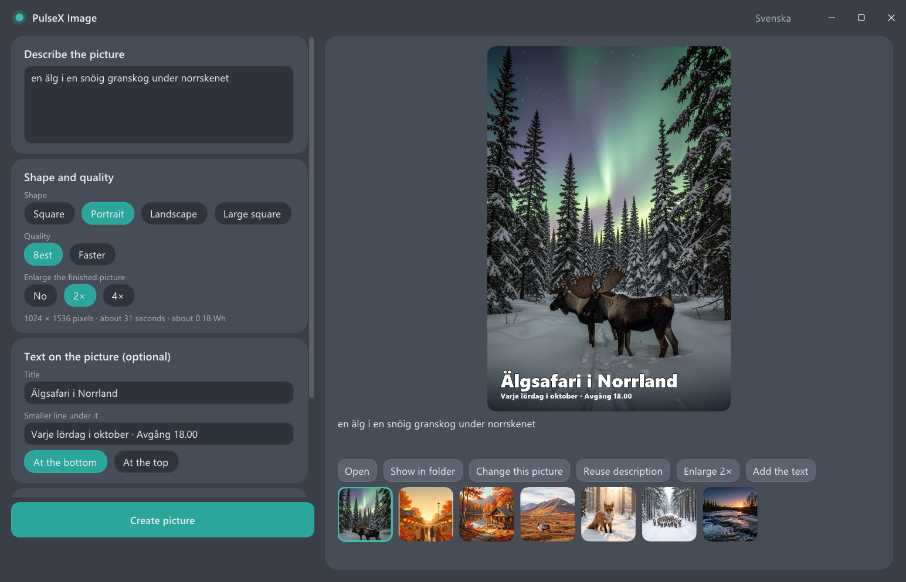
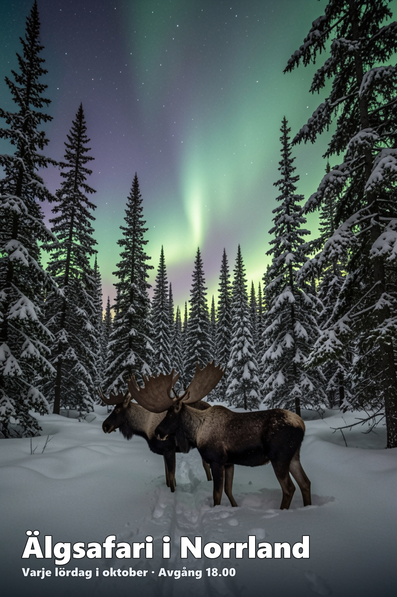

# PulseX Image

Pictures and posters from a description, made on the NPU of a Snapdragon X laptop: no graphics card, no cloud, and
about 0.15 Wh per picture for the whole computer. It runs **FLUX.2 [klein] 9B** (Black Forest Labs), quantised to 8 or
4 bits, entirely on the Hexagon NPU.

| The window | A poster |
|---|---|
|  |  |

(The pictures were generated with FLUX.2 [klein] by this program.)

## What it does

- **A description in, a picture out** - 22 seconds for 512 x 512 on a Snapdragon X Plus, 61 seconds for 1024 x 1024.
- **Four shapes**: square, portrait (512 x 768), landscape (768 x 512), large square (1024 x 1024).
- **Enlarging** 2x or 4x (up to 2048 on the short side): a portrait poster becomes 1024 x 1536 or 2048 x 3072.
- **Text on the picture**: a title and a smaller line, at the bottom or the top. The text is put on afterwards, so it
  is spelled as you typed it - a model asked to draw letters draws texture that looks like text.
- **Start from a picture of your own** (up to two): drop it on the window and describe what to change.
- **Swedish words are understood**: "en älg i en snöig granskog under norrskenet" gives a moose, "renar på
  höstfjället" gives reindeer. English always works.
- Pictures are saved as JPEG (quality 95) or PNG in `Pictures\PulseX`, never over an existing file, and the window
  remembers the description behind each one.

## Measured

On battery, pictures made back to back, the whole computer (screen included), Snapdragon X Plus X1P-42-100:

| | Time per picture | Power | Energy per picture | Pictures on a full battery (60.5 Wh) |
|---|---|---|---|---|
| Best (Q8), 512 x 512 | 24 s | 22 W | 0.15 Wh | about 410 |
| Faster (Q4), 512 x 512 | 21 s | 21 W | 0.13 Wh | about 470 |
| Best (Q8), 1024 x 1024 | 67 s | 20 W | 0.37 Wh | about 160 |

The idle computer draws 7 W. The figures come from the battery's own gauge over long runs and are good to about
10 %. No comparison with a graphics card or a data centre was measured, and none is claimed.

## What you need

- A **Snapdragon X** laptop with Windows 11 on ARM64. Tested on Snapdragon X Plus (X1P-42-100, Hexagon NPU v73) with
  16 GB of memory. Other Snapdragon X chips are untested; the picture decoder on Hugging Face is compiled for this
  chip.
- The [Microsoft Visual C++ Redistributable for ARM64](https://aka.ms/vs/17/release/vc_redist.arm64.exe).
- Three files of **Qualcomm's AI runtime (QAIRT), version 2.46 or newer**: `QnnHtp.dll`, `QnnSystem.dll` and
  `QnnHtpV73Stub.dll`, from `lib\aarch64-windows-msvc` of the QAIRT SDK. They are Qualcomm's and are not in this
  repository. (The copies inside the `onnxruntime-qnn` Python package are older and refuse the decoder.)
- The **models** from Hugging Face (below). 10 to 26 GB on a fast SSD.

> **The NPU module is self-signed.** Windows only loads `bin\libggml-htp-v73.so` on a machine set up to accept
> self-signed NPU modules (a developer setup). On a stock machine the NPU part is refused; that needs a
> Microsoft-attestation-signed module, which this project does not have yet.

## Set up

1. Take the zip of the [latest release](https://github.com/Erik-matrix/pulsex-image/releases/latest) or clone the
   repository, into a folder whose path is plain A-Z (for example `C:\PulseX\image`).
2. Put the three Qualcomm files in a folder `qnn` next to `bin`.
3. Get the models into a folder `models` next to `bin`:

   ```
   hf download Pexqman/FLUX.2-klein-9B-hexpack --local-dir models
   ```

   (`pip install huggingface_hub` gives the `hf` command. You have to accept the model's license on its page first;
   add `--include "q8/*" "vae-qnn/*"` to take only the Best quality, 17 GB, or `--include "q4/*" "vae-qnn/*"` for Faster, 10 GB.)
4. Run `bin\pulsex-image.exe`.

```
pulsex-image\
  bin\        the program (this repository)
  qnn\        QnnHtp.dll, QnnSystem.dll, QnnHtpV73Stub.dll
  models\
    q8\       flux-2-klein-9b-q8_0-slim.gguf + .hexpack, qwen3-8b-flux2-q8_0-slim.gguf + .hexpack
    q4\       the same in Q4_0
    vae-qnn\  the picture decoder and encoder, one compiled file per shape, and bn.f32
```

`bin\flux.json` says where these are (paths relative to itself); edit it to keep the models elsewhere. The window
offers what it finds: a shape needs its decoder file, "Best" and "Faster" need their model files, starting from a
picture of your own needs the encoder of that shape. Enlarging needs one more file that is not on Hugging Face - see
*Enlarging* below.

## Use

Type a description, choose a shape, press **Create picture**. The bar shows the steps and how long is left.
Under the picture: open it, show it in its folder, change it (it becomes the picture to start from), use its
description again, enlarge it 2x, or add the text that is typed. *More settings* has the variation number (the same
number and description give the same picture), the number of steps, PNG instead of JPEG, and the help with Swedish
words.

Closing the window while a picture is being made waits for the picture: an engine is never killed with the NPU open.

## The command line

The window runs `flux-make.exe`, which you can use directly (from the `bin` folder):

```
flux-make "a red fox in a snowy forest at dawn" [--size 512|WxH] [--seed N] [--steps 4] [--model q4|q8]
          [--up 1024|2048] [--title "Summer Sale"] [--sub "Friday 6 pm"] [--top] [--image picture]...
          [--enrich nouns] [--out file.jpg|file.png] [--quality 95]
flux-make --add-text picture.png --title ... [--sub ...] [--top] [--out file]      text on an existing picture
flux-make --enlarge picture.png [--up N] [--out file]                              an existing picture enlarged
```

## Enlarging

Enlarging uses QuickSRNet-Large x4 from [Qualcomm AI Hub](https://aihub.qualcomm.com/) as a compiled NPU graph
(`quicksrnetlarge_512x512_ctx_qnn.bin`, for a 512 x 512 input; larger pictures go through it as overlapping tiles
that cross-fade). The file is not redistributed here. `flux.json` names where it is expected
(`models\sr-qnn\`); without it the window simply does not offer enlarging.

## How it works

Each stage is a short-lived program that opens the NPU, does one thing and closes it:

| Stage | Program | What |
|---|---|---|
| text | `flux-encode.exe` | Qwen3 8B, 27 layers streamed through the NPU, hidden states after layers 9 / 18 / 27 |
| picture tokens | `flux-stream.exe` | the transformer: 8 double + 24 single blocks streamed block by block, 4 steps |
| picture | inside `flux-make.exe` | the VAE decoder as a compiled QNN graph (0.4 s at 512 x 512) |

The weights never sit in memory all at once: a block is read from the `.hexpack` (the NPU's own layout, written
once), used, and replaced by the next, with the following block read ahead on a thread. That is why a 9-billion
parameter model runs on a 16 GB laptop. A "slim" GGUF holds the metadata and the few tensors the processor needs;
the `.hexpack` beside it holds the rest. The two belong together by a key stored in both, so they can be copied and
downloaded.

The engines are built on [llama.cpp / ggml](https://github.com/ggml-org/llama.cpp) with a Hexagon NPU backend
(`ggml-hexagon`), the same fork as [pulsex-zimage](https://github.com/Erik-matrix/pulsex-zimage).

## Build

The binaries in `bin\` are prebuilt. The sources in `src\` build inside the PulseX fork of ggml-hexagon (as
`examples/flux_dit`, with `-DFLUX_QNN_INCLUDE=<QAIRT SDK>/include/QNN` for `flux-make` and
`-DFLUX_IMGUI_DIR=<Dear ImGui>` for the window). The fork itself is not in this repository.

## License

The code in this repository is released under the [MIT License](LICENSE); see
[THIRD_PARTY_NOTICES.md](THIRD_PARTY_NOTICES.md) for what it is built with.

**The model is not MIT.** FLUX.2 [klein] 9B and everything made from its weights - the files on Hugging Face - are
under the [FLUX Non-Commercial License](https://huggingface.co/black-forest-labs/FLUX.2-klein-9B/blob/main/LICENSE.md)
of Black Forest Labs: free for personal, research and other non-commercial use. No model file is in this repository.
The pictures you make are yours to use; you are responsible for them, and for saying that they are AI-generated where
the law requires it. This project is not affiliated with or endorsed by Black Forest Labs.
